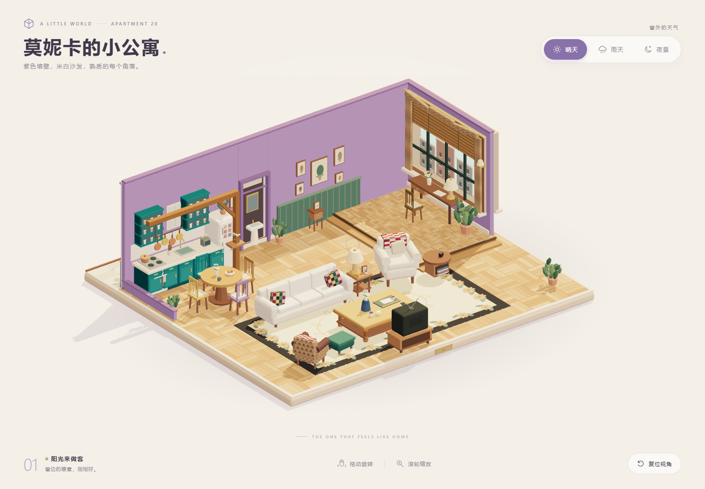
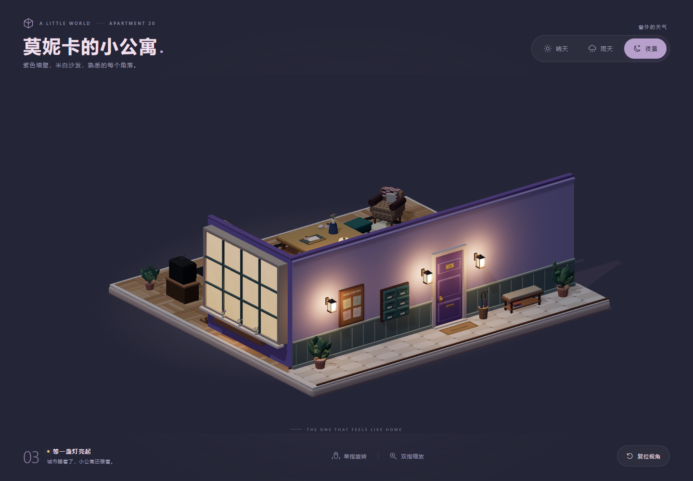

# 莫妮卡的小公寓

可离线打开的 Three.js 低多边形公寓微缩场景，依据 Vogue 发布、署名 Getty Images 的莫妮卡公寓片场全景调整布局与装饰。



参考来源：[Vogue，2016 年 2 月 21 日](https://www.vogue.com/article/friends-apartment-how-to-get-the-look-monica-geller-cast-reunion)。场景采用米白三人沙发、拼布靠垫、深边花卉地毯、方形木茶几、右侧扶手椅，以及带竹帘和书桌的抬高窗区；厨房保留蓝绿色橱柜、木梁和圆餐桌，中间为紫色走廊门洞。尺寸和细节为适应低多边形微缩展示作了简化，未嵌入或修改参考照片。

室内留出餐区、沙发背后及茶几周围的通道。大窗位于右侧转折墙面，书桌朝向窗户；窗外雨线、月亮和城市背景共用窗户的局部坐标，随窗区一起转向。默认视角从前左侧看入，能同时观察厨房与大窗。

背面装饰：为完整的旋转观看体验，在后墙外补充一条装饰走廊，包含 20 号门、壁灯、信箱、留言板、长凳、雨伞篮、迎宾垫与盆栽；窗户外侧增加窗框、反光玻璃和花箱。走廊向后延伸 2 个场景单位，底座总尺寸为 17.6 × 15.8，室内家具布局保持不变。壁灯和外窗暖光随天气切换。

客厅电视放在茶几正前方，与茶几中心对齐，屏幕正对茶几，配有木质电视柜、录像机和录像带；遥控器放在茶几上。



## 打开

从 [Releases](https://github.com/taikongren776/friends-monica-s-apartment/releases) 下载发布包，解压后双击 **index.html**；也可以下载本仓库，直接打开根目录的 **index.html**。使用支持 WebGL 的 Chrome、Edge 或 Firefox 浏览器。文件已包含 Three.js、OrbitControls、场景、样式和所有程序生成纹理，无需安装 Node.js、联网或运行服务器。

- 鼠标拖动旋转，滚轮缩放。
- 手机单指旋转，双指缩放。
- 点击「晴天」「雨天」「夜景」切换环境，视角保持不变。
- 点击「复位视角」还原全景；画布获得键盘焦点后也可以按 Home。
- 系统开启「减少动态效果」时，天气立即切换，雨滴动画暂停。

## 修改与重建

需要 Node.js 及 npm。首次安装构建依赖需要网络，生成的 HTML 无此要求。

```powershell
npm ci
npm run build
```

- `src/model.js`：程序生成的家具、房间、装饰与纹理。
- `src/scene.js`：相机、OrbitControls、天气状态、灯光、动画与窗口适配。
- `src/page.html` 和 `src/style.css`：中文界面与响应式样式。
- `scripts/build.mjs`：将代码、Three.js 与样式内嵌到根目录 HTML。
- `RELEASE_NOTES.md`：v1.0.0 发布说明。

依赖固定为 Three.js 0.180.0 和 esbuild 0.28.2。无需外部 API、远程模型、图片或字体。

## 浏览器验收

使用 Playwright CLI 在 Chrome 中打开 `index.html#inspect`，可运行 `scripts/verify-browser.js` 检查实际交互。`#inspect` 只启用只读验收诊断；正常打开不暴露诊断接口。

验收涵盖断网 `file://` 加载、三种环境、雨滴的动画与室外边界、视角保持、旋转缩放复位、单指与双指手势、反复切换时的资源复用、手机布局、减少动态效果和浏览器错误。截图保存在 `output/playwright/`。

Three.js 及其附加模块遵循 MIT 许可证，许可证随独立 HTML 内嵌。

README 中的图片是本项目生成的场景截图。原始参考照片未包含在仓库或网页中；背面走廊为微缩模型补充设计。
